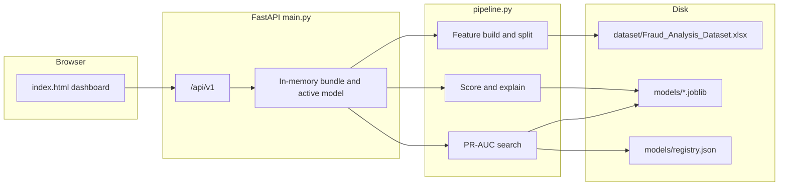
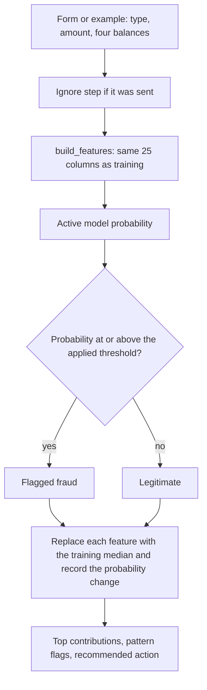

# FraudIntel

Post-transaction fraud scoring for the bundled PaySim sample `dataset/Fraud_Analysis_Dataset.xlsx`. The browser dashboard, the API, and the model files all live in this folder. There is no upload: the app is built for this file.

`Fraud_Detection.ipynb` is the specification. `pipeline.py` repeats its feature formulas, the 60/20/20 split, and the section 4b hyperparameter search. `main.py` serves the page and the API. `index.html` is the dashboard.

## How to run

From this folder (the one that contains `main.py`):

```bash
python -m venv .venv
source .venv/bin/activate
pip install -r requirements.txt
python -m uvicorn main:app --host 127.0.0.1 --port 8000
```

With the existing conda environment:

```bash
conda activate aiml
python -m uvicorn main:app --host 127.0.0.1 --port 8000
```

Open http://127.0.0.1:8000. Interactive API docs are at http://127.0.0.1:8000/docs.

On startup the process loads the spreadsheet, builds features, freezes the split, and loads the active model from `models/registry.json` when that file exists. Health check:

```bash
curl http://127.0.0.1:8000/api/v1/health
```

The dataset is resolved in this order:

1. `dataset/Fraud_Analysis_Dataset.xlsx` next to `main.py`
2. `Fraud_Analysis_Dataset.xlsx` next to `main.py`
3. `dataset/Fraud_Analysis_Dataset.xlsx` one or two folders above

Required columns: `step`, `type`, `amount`, `nameOrig`, `oldbalanceOrg`, `newbalanceOrig`, `nameDest`, `oldbalanceDest`, `newbalanceDest`, `isFraud`. Types must be `CASH_IN`, `CASH_OUT`, `DEBIT`, `PAYMENT`, `TRANSFER`.

## Architecture



| Piece | Role |
| --- | --- |
| `index.html` | Sidebar dashboard. Data and Preprocessing scroll. Train, Insights, and Inference stay on one screen. The train log is the only scroller on Train. |
| `main.py` | Loads the dataset at startup, serves the page, trains in the background, saves and loads models, scores transactions. |
| `pipeline.py` | Feature formulas, split, search, thresholds, importance, explanations. |
| `models/` | One joblib artifact per saved model, plus `registry.json` for the active file and the last comparison. |
| `Fraud_Detection.ipynb` | Source of the feature function and the search ranges. |

The page talks only to this process (`/api/v1`). A second tune is rejected with HTTP 409 until the current job finishes.

## Dashboard

| Sidebar | What it shows |
| --- | --- |
| Data | Raw-file KPIs, type and amount charts, the step chart that shows why `step` is dropped, and the held-out test table once a model is loaded. |
| Preprocessing | Pipeline cards, columns left out, the frozen split, flag rates, and the 25 model columns by group. |
| Train | Checkboxes for the models to tune, saved-model Use / Delete / Save copy, and a scrolling log. |
| Insights | Test-split precision, recall, F1, profit, threshold slider, ROC, precision-recall, confusion, importance, cost, and money. |
| Inference | Model picker, example chips, score form, flags, and the local contribution chart. |

## Pipeline

Scenario is post-transaction: balances after the payment are known and are features. `step` is accepted by the score API and then ignored, because in this file legitimate rows stop early and later steps are fraud.

```mermaid
flowchart TD
  A["Read Fraud_Analysis_Dataset.xlsx"] --> B["Check columns, types, unique index"]
  B --> C["Cast type, isFraud, amounts, balances, step"]
  C --> D["Drop nameOrig and nameDest"]
  D --> E["Drop step: legitimate rows stop early, later steps are fraud"]
  E --> F["log_amount = log1p amount"]
  F --> G["Keep raw old and new balances for sender and recipient"]
  G --> H["origChange = oldOrig - newOrig"]
  H --> I["destChange = newDest - oldDest"]
  I --> J["errOrig = oldOrig - newOrig - amount"]
  J --> K["errDest = oldDest + amount - newDest"]
  K --> L["One-hot type: CASH_IN, CASH_OUT, DEBIT, PAYMENT, TRANSFER"]
  L --> M["log1p of the four balances"]
  M --> N["orig_emptied: newOrig is 0 and oldOrig is above 0"]
  N --> O["amount_eq_oldbal: amount equals oldOrig"]
  O --> P["dest_zero: both recipient balances are 0"]
  P --> Q["orig_recon_ok and dest_recon_ok: absolute error under 1"]
  Q --> R["risky_type: TRANSFER or CASH_OUT"]
  R --> S["emptied_risky: orig_emptied times risky_type"]
  S --> T["25 columns, fixed order, no missing values"]
  T --> U["Stratified split, seed 42: 60 percent train, 20 percent validation, 20 percent test"]
  U --> V{"Which models were checked?"}
  V --> W["Each selected model in its own process"]
  W --> X["3-fold stratified CV on the training rows only"]
  X --> Y["Score is average precision, PR-AUC"]
  Y --> Z{"Model"}
  Z --> ZA["Logistic Regression: grid on C, scaler inside each fold"]
  Z --> ZB["Random Forest, XGBoost, LightGBM: 12 random draws"]
  ZA --> ZC["Refit the winner on the full training split"]
  ZB --> ZC
  ZC --> ZD["Score validation and test"]
  ZD --> ZE["Max-F1 threshold and min-cost threshold on validation"]
  ZE --> ZF["Save joblib and registry card"]
  ZF --> ZG["Active model is the highest validation PR-AUC in this run"]
  ZG --> ZH["Insights use the untouched test split"]
  ZH --> ZI["Inference rebuilds the same 25 features and returns a probability"]
```



### Feature groups

| Group | Columns |
| --- | --- |
| Amount and balances | `log_amount`, four raw balances, four `log1p` balances |
| Ledger | `origChange`, `destChange`, `errOrig`, `errDest`, `orig_recon_ok`, `dest_recon_ok` |
| Type | five one-hot columns, `risky_type` |
| Patterns | `orig_emptied`, `amount_eq_oldbal`, `dest_zero`, `emptied_risky` |

Logistic regression is the only model with a scaler. The scaler sits inside the training pipeline, so each cross-validation fold fits it on that fold's training rows. Validation and test never fit it.

### Split and search

| Rule | Value |
| --- | --- |
| Seed | 42 |
| Split | Stratified 60% train, then the remaining 40% split in half into validation and test |
| Folds | 3-fold `StratifiedKFold`, shuffle, seed 42, training rows only |
| Search metric | Average precision (PR-AUC) |
| Logistic Regression | `GridSearchCV` over `C` in 0.01, 0.1, 1, 10, 100. `class_weight=balanced`. |
| Random Forest | 12 draws. Trees 200 or 400, depth 4, 6, 8, or 12, leaf 2, 5, 10, or 20, `max_features` sqrt or 0.5. `class_weight=balanced`. |
| XGBoost | 12 draws. Trees 150, 300, or 500, depth 2–5, learning rate 0.03, 0.05, or 0.1, subsample and column sample 0.7 / 0.85 / 1.0 and 0.6 / 0.8 / 1.0, `min_child_weight` 1, 3, or 5, `reg_lambda` 1, 5, or 10. `scale_pos_weight` is fixed from the training split. |
| LightGBM | 12 draws. Trees 150, 300, or 500, leaves 7, 15, or 31, depth -1, 4, or 6, same learning rate and subsample grid, `min_child_samples` 10, 20, or 40, `reg_lambda` 1, 5, or 10. `scale_pos_weight` is fixed. |

Checked models train at the same time, one process each, one core inside that process. A single checked model uses every core. When the job finishes, the model with the highest validation PR-AUC from that run becomes the scoring model. Use on the Train page, or the model menu on Inference, switches the active file without another search.

### Thresholds

Both thresholds are chosen on the validation probabilities, on 200 log-spaced cutoffs from 0.0001 to 0.99.

- Max-F1 is the default applied threshold.
- Min-cost minimizes missed fraud amount, plus 25 for every alert, plus a 1% fee on legitimate amount that would be blocked.

Displayed profit counts the 1% fee once, only on legitimate payments that are approved. It does not subtract that fee a second time. The slider on Insights changes the applied threshold used for new scores.

### Score one transaction



## API

| Method | Path | Purpose |
| --- | --- | --- |
| GET | `/api/v1/health` | Dataset rows, active model, threshold |
| GET | `/api/v1/metadata` | Scenario, feature list, search notes |
| GET | `/api/v1/dataset/summary` | Raw-file charts and findings |
| GET | `/api/v1/preprocessing` | Steps, groups, flag rates, split |
| GET | `/api/v1/models` | Saved files and which one is active |
| POST | `/api/v1/train` | Body `{"models": ["XGBoost", "LightGBM"]}`. Returns a job id. |
| GET | `/api/v1/train/status` | Poll until `complete` or `failed` |
| POST | `/api/v1/models/save` | Copy of the active model under a new filename |
| POST | `/api/v1/models/load` | Make a saved file the scoring model |
| DELETE | `/api/v1/models/{filename}` | Delete a joblib file. Names must stay inside `models/` |
| POST | `/api/v1/threshold` | Set the applied threshold |
| GET | `/api/v1/metrics` | Headline metrics for the active model |
| GET | `/api/v1/evaluation` | Test curves, confusion inputs, importance |
| POST | `/api/v1/predict` | Score one transaction |
| POST | `/api/v1/predict/batch` | Score up to 20,000 transactions |

Train example:

```bash
curl -X POST http://127.0.0.1:8000/api/v1/train \
  -H 'Content-Type: application/json' \
  -d '{"models": ["Logistic Regression", "Random Forest", "XGBoost", "LightGBM"]}'

curl http://127.0.0.1:8000/api/v1/train/status
```

Score example:

```bash
curl -X POST http://127.0.0.1:8000/api/v1/predict \
  -H 'Content-Type: application/json' \
  -d '{"type":"TRANSFER","amount":181,"oldbalanceOrg":181,"newbalanceOrig":0,"oldbalanceDest":0,"newbalanceDest":0}'
```

## Saved models

Artifacts are `models/<name>.joblib` plus `models/registry.json`. A copy uses the name you type, restricted to letters, numbers, `_`, and `-`, and the path must stay inside `models/`. Deleting the active file activates the remaining model with the highest validation PR-AUC.
